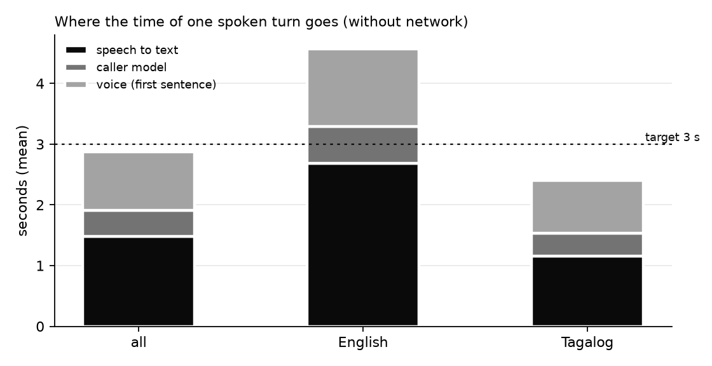
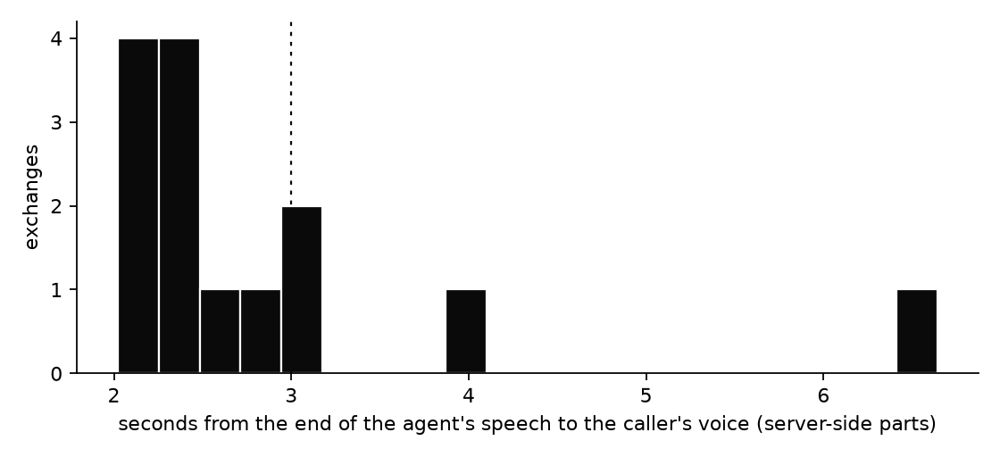

# Evaluation results

Generated 2026-11-04. Every number comes from the logs and recordings listed in each section; small samples are marked with 95% intervals where it matters.

## 1. Fatigue detection (scripted recordings)
_No recordings scored yet. Record sessions with `record_session.py`, then run `evaluate_fatigue.py`._

## 2. Face verification
_No identity trials yet. Enroll volunteers and collect attempts with `identity_trials.py`, then run `analyze_identity.py`._

## 3. Spoofing attacks
_No attack trials yet. Run `spoof_trials.py` for the real person and for each kind of fake, then `analyze_spoof.py`._

## 4. Voice loop delay
| group | part | exchanges | mean | median | 95th percentile | slowest |
|---|---|---|---|---|---|---|
| all | speech to text | 14 | 1.48 s | 1.12 s | 2.87 s | 4.83 s |
| all | caller model | 14 | 0.43 s | 0.37 s | 0.72 s | 1.09 s |
| all | voice (first sentence) | 14 | 0.95 s | 0.89 s | 1.46 s | 1.54 s |
| all | total | 14 | 2.87 s | 2.39 s | 4.96 s | 6.64 s |
| English | total | 3 | 4.57 s | 4.05 s | 6.38 s | 6.64 s |
| Tagalog | total | 11 | 2.40 s | 2.31 s | 2.95 s | 3.05 s |

The server-side parts only (speech to text, caller model, first spoken sentence). The client's own timer, which also includes the network, measured 3.1-3.3 s per turn plus a 0.5 s end-of-speech pause.

## 5. Performance on the agent PC
| mode | frames per second | mean ms/frame | 95th percentile ms | CPU (% of one core) | memory MB | meets 15 fps |
|---|---|---|---|---|---|---|
| detection | 44.3 | 22.57 | 33.54 | 111.0 | 282.0 | yes |
| detection + identity | 43.2 | 23.15 | 26.86 | 198.0 | 499.0 | yes |
